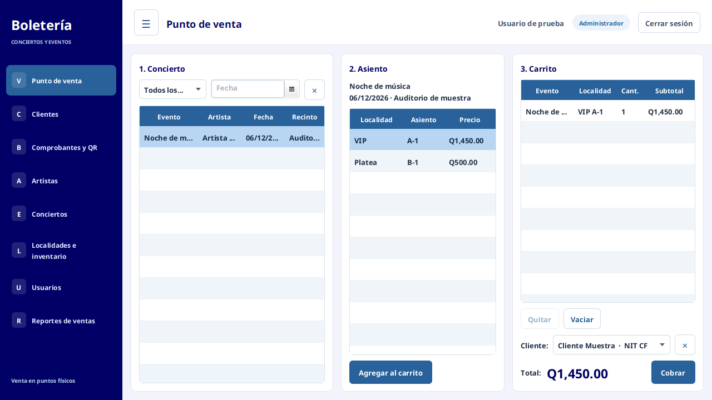

# Boletería · SVB-GUA

Cliente JavaFX para el proyecto de Programación II. Se conserva el punto de venta del ZIP actualizado del equipo, incluidos sus precios finales. Este repositorio contiene una copia preparada para integrar comprobantes y boletos con QR; no sustituye automáticamente la aplicación de tu computadora ni la API de tus compañeros.

## Interfaz integrada

Se adaptó el diseño visual del ZIP Swing recibido a JavaFX: menú lateral azul, tablas con filas alternadas, login renovado y navegación que conserva el carrito y los módulos existentes. No se reemplazó la lógica por la versión Swing ni se cambiaron las tarifas.

[Guía para copiar los seis archivos a tu NetBeans](docs/INTERFAZ.md)

## Ejecutar en NetBeans / Windows

1. Descargar el proyecto desde GitHub (Code → Download ZIP), extraerlo y abrir la carpeta que contiene pom.xml en NetBeans. Conservar el proyecto anterior como respaldo.
2. Usar JDK 25 o 26 (JavaFX 26.0.1 requiere al menos JDK 24). El código de la aplicación se compila con release 17, pero las bibliotecas JavaFX necesitan un JDK reciente.
3. Ejecutar `mvn clean package -Pjar-ejecutable` y `mvn javafx:run`, o Clean and Build / Run desde NetBeans.
4. Compilar en Windows para crear un JAR que incluya las bibliotecas JavaFX de Windows; no usar en Windows un JAR generado para Linux.

La API por defecto es `https://proyectoapi2026.onrender.com/api`. Se puede cambiar mediante BOLETOS_API_URL o la propiedad JVM api.url. No hace falta conectar el cliente a PostgreSQL ni introducir claves de la BD.

## Comprobantes y boletos

Entrar en **Comprobantes**, indicar una venta existente y guardar el PDF. La primera página contiene fecha de venta en Guatemala, nombre de evento, vendedor, cliente, teléfono, tipo de entrada, cantidad, precio por boleto, total pagado y observaciones. Siguen los boletos individuales con fecha legible y QR.

El código QR contiene una URL HTTPS real. Si la API todavía no tiene la página visual, abre el registro JSON del detalle existente; no envía un identificador a una búsqueda de Google. Cuando el backend entregue qr_url, abre la página visual firmada automáticamente. No incluye teléfonos, nombres ni contraseñas dentro del QR.

**Importante:** el botón *Guardar comprobante y boletos PDF* de una venta existente no vuelve a cobrar ni envía un correo. El envío automático se integra en el backend al completar una venta nueva. Los módulos están en [backend-para-integrar](backend-para-integrar/INTEGRACION.md); todavía requieren publicación por el propietario de Proyectoapi2026 y configuración de Render. No afirmar envío o entrega real hasta verificarlo.

Para otros vendedores, el nombre completo requiere que la API devuelva vendedor_nombre. Si no lo hace, se usa el nombre de sesión para ventas propias, o Vendedor #ID. No se consulta el endpoint de usuarios que devuelve credenciales.

## Envío del comprobante por Gmail (desde Java)

El programa puede enviar el comprobante con los boletos al correo del cliente directamente con SMTP de Gmail, sin depender de la API: automáticamente al cobrar una venta y, de forma manual, desde *Comprobantes y QR*. Requiere crear una contraseña de aplicación de Gmail y el archivo `correo.properties` (no se sube a GitHub). Pasos en [docs/CORREO_GMAIL.md](docs/CORREO_GMAIL.md). Si el archivo no existe, la venta funciona igual y no se envía nada.

## Reportes de ventas (administrador)

La pestaña **Reportes** permite combinar filtros por concierto, artista y vendedor, consultar el resultado y exportarlo a PDF con JasperReports. Usa los importes registrados en los detalles de venta, no precios actuales. Si una compra contiene varios conciertos, cada filtro suma solo sus detalles; no duplica el total de la compra. Incluye total, número de boletos y ventas distintas representadas.

[Instrucciones para copiar el código a NetBeans](docs/REPORTES.md) · [PDF de muestra con datos ficticios](docs/reporte-ventas-ejemplo.pdf)

Las ventas sin detalles se indican en el aviso y no se cuentan como boletos vendidos. Si faltan asociaciones necesarias, el reporte pide revisar/recargar los datos en vez de inventar una cifra. Un artista con ID 0 es compatible. Los vendedores aparecen por ID cuando la API no entrega su nombre. Los nombres de artista/concierto provienen del catálogo actual.

Verificado: build/package, pruebas de filtros y asignación por concierto, interfaz JavaFX real, PDF sin resultados y paginación de 70 filas. Se realizó también una consulta de solo lectura contra la API existente. No se crearon ni borraron ventas, clientes o conciertos.

## Ejemplo con datos ficticios

[Ver PDF de muestra](docs/comprobante-ejemplo.pdf). No es una venta nueva ni contiene información de clientes reales.

## Verificación realizada

- Build y empaquetado con Maven/JDK 26; las clases nuevas también compilan con release 17.
- Comprobante con dos boletos: tres páginas, fechas legibles y total Q1,225 usando datos ficticios.
- Lectura del QR desde una imagen del PDF y respuesta HTTP 200 del registro público existente.
- Backend: `cd backend-para-integrar && npm ci && npm test` con modelos y correo simulados; enlace firmado, rechazo de alteraciones, página Express, privacidad de datos de contacto, adjunto PDF y bloqueo de totales inconsistentes.
- No se enviaron correos reales ni se escribieron ventas en las pruebas del asistente.

## Límites pendientes

La página visual y el correo automático necesitan desplegar el backend; la cuenta VaneSiam no tenía permiso de escritura en aruizv5-commits/Proyectoapi2026 al preparar esta versión. No hay validación de ingreso ni prevención de reutilización del boleto. Autenticación del servidor, transacciones atómicas y copia histórica de datos son pendientes independientes.

Los comprobantes usan nombres actuales de los catálogos; eliminar un cliente/concierto asociado puede impedir reimprimirlos. Los importes se toman de los detalles históricos, no de los precios actuales. Este es un documento académico, no una factura fiscal.

## Seguridad y colaboración

No incluir contraseñas, archivos .env ni credenciales en Git. La clase JDBC heredada solo lee variables si alguien la usa explícitamente; JavaFX normal consume la API. Si una contraseña apareció en versiones anteriores o capturas, cambiarla en el proveedor correspondiente.

Cada tarea de nube ya está aislada: usar el checkout existente; no es necesario crear worktrees para preparar este proyecto.
